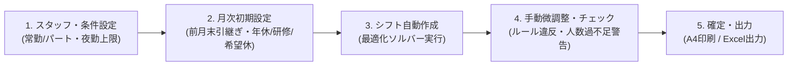

# ナースエイド勤務表アプリ 基本設計書

## 1. 概要・目的
### 1.1 背景と目的
本システムは、小規模チーム（10名未満）のナースエイド（看護補助者）を対象とした勤務表（シフト表）作成・管理アプリケーションである。
「夜勤・明け・休みの100%セット」「パートを含む日の日勤人数調整」「夜勤前の日勤連勤制限」「個人事情を優先した上での夜勤回数の均等化」といった院内固有のルールを正確に反映し、**簡単な操作で自動作成・微調整・印刷出力できること**を目的とする。

### 1.2 ターゲット規模・運用想定
- **対象人数**: ナースエイド 10名未満（常勤＋パート）
- **利用者**: 勤務表作成担当者（看護師長・主任・リーダー等）
- **運用方針**:
  - 複雑なサーバー構築を省き、院内PCのブラウザですぐに使えるシンプルで軽快なWebアプリケーション構成とする。
  - 希望休や研修（`年`・`研`・固定`休`）を先にピン留めし、数理最適化／制約充足アルゴリズムで自動作成したあと、画面上で微調整できるハイブリッド方式とする。

---

## 2. 勤務区分と勤務時間定義

使用する勤務区分は以下の **6種類** とする。

| 記号 | 名称 | 対象 | 勤務時間 | 備考 |
| :---: | :--- | :--- | :--- | :--- |
| **日** | 日勤 | 常勤 | `08:30 - 17:20` | 常勤の基本日勤 |
| **日** | 日勤（パート） | パート | `08:30 - 14:00` | パート用の短時間日勤（画面上は同じ「日」または「日(パ)」で識別） |
| **夜** | 夜勤入り | 常勤 | `16:30 - 23:59` | 翌日「明」、翌々日「休」と100%セット |
| **明** | 夜勤明け | 常勤 | `00:00 - 09:00` | 前日「夜」の翌日に自動配置 |
| **休** | 公休 | 全員 | 終日 | 所定の休日（パートは土日祝すべて「休」） |
| **年** | 年休（有給） | 全員 | 終日 | 年次有給休暇（事前指定・ロック対象） |
| **研** | 研修 | 全員 | 終日 | 院内外の研修・出張等（事前指定・ロック対象） |
| **夜外** | 夜勤以外（条件スタンプ） | 常勤 | 自動割当 | **「夜」のみ不可**とし、自動作成時に**「日」「明」「休」**のいずれかを割り当てる指定スタンプ |
| **明/休** | 明または休（条件スタンプ） | 常勤 | 自動割当 | **「日」「夜」を不可**とし、自動作成時に**「明」または「休」**のいずれかを割り当てる指定スタンプ |

---

## 3. シフト作成ルール・制約条件定義

本アプリの自動作成エンジンおよびリアルタイム警告チェックで適用するルールを以下に定義する。

### 3.1 1日あたりの必要人数ルール（最低〜最高人数）

| 曜日区分 | 勤務区分 | 最低人数 | 最高人数 | 特別条件・備考 |
| :--- | :---: | :---: | :---: | :--- |
| **平日** | **日勤 (`日`)** | **2名** | **3名（パート含めば4名）** | **【重要】日勤にパートを含む場合は「3〜4名」とする**<br>（パートは14:00退勤のため、パートを含めて合計3〜4名体制でカバー） |
| **休日 (土日祝)** | **日勤 (`日`)** | **1名** | **2名** | パートは土日祝休みのため、常勤のみで1〜2名配置 |
| **平日** | **夜勤 (`夜`)** | **1名** | **2名** | 翌日の「明」も連動して1〜2名となる |
| **休日 (土日祝)** | **夜勤 (`夜`)** | **1名** | **2名** | 翌日の「明」も連動して1〜2名となる |

### 3.2 夜勤・連勤・シフトパターンに関するルール

1. **「夜 → 明 → 休」100%セットルール（絶対制約）**
   - `夜` に入った翌日は必ず `明`、翌々日は必ず `休` とする（`[夜][明][休]` の3日固定ブロック）。
   - 手動編集で `夜` を入力した際も、自動的に翌日 `明`・翌々日 `休` がセットされる補助機能を備える。
   - **月跨ぎ処理**: 前月末日が `夜` のスタッフは当月1日を `明`・2日を `休`、前月末日が `明` のスタッフは当月1日を `休` として初期固定する。

2. **連続日勤および夜勤前の日勤連続数ルール**
   - **連続日勤の上限**:
     - **基本（推奨）**: 連続日勤は **3日勤まで**（`1〜3日勤`）を基本とする。
     - **許容（ペナルティ小）**: **4日勤** までは許容するが、**4日勤の翌日は必ず「休」（または「年」）とする**（5日勤以上は不可）。
   - **夜勤前の日勤連続数**:
     - **基本（推奨）**: 夜勤前の連続日勤は **0〜2日勤** までとする。
       - ◯ `休 → 夜`（0日勤）
       - ◯ `休 → 日 → 夜`（1日勤）
       - ◯ `休 → 日 → 日 → 夜`（2日勤）
     - **許容（ペナルティ小）**: **3日勤 → 夜**（`休 → 日 → 日 → 日 → 夜`）まではやむを得ない場合に許容する（画面上は軽微な注意表示）。
     - **不可（絶対禁止）**: **4日勤以上 → 夜**（`日 → 日 → 日 → 日 → 夜`）は不可とする。

3. **連続夜勤に関するルール**
   - 基本は夜勤サイクルを連続させない（`夜 → 明 → 休` のあとに `日` や追加の `休` を挟む）ことを優先する。
   - やむを得ない場合でも **2夜勤連続**（`夜 → 明 → 休 → 夜 → 明 → 休`）までを許容上限とし、3夜勤連続は不可とする。

4. **パートスタッフのルール（絶対制約）**
   - **土日祝は100%「休」**（または事前指定の「年」）。
   - 勤務時間は `8:30 - 14:00` の `日`（および `休`・`年`・`研`）のみとし、`夜`・`明` は割り当てない。

5. **設定されている週休数の厳守（絶対制約・必須ルール）**
   - 月ごとに自動算出（または手動編集）された「週休数」（およびスタッフ個別に編集された「週休数」）に対し、各スタッフの「休」の合計日数が**完全に一致すること**を必須ルール（ハード制約）とする。
   - 1日でも過不足がある場合は必須ルール違反（赤表示・エラー）として検出し、自動作成ソルバーでも連鎖調整により設定週休数を厳守する。

6. **「年（年休）」入力箇所の「休 / 年」扱いと別日への「年」自動振替ルール**
   - 手入力で `年` が入力されたマスは **`休` または `年` のいずれか（100%休み）** として扱う。
   - 自動作成で2日前に `夜` が配置され該当マスが `夜→明→休` の `休` になった場合、または手動で `年` のマスを `休` に変更した場合は、設定週休数と年休数の両方を維持するため、**そのスタッフの別の休日に自動で `年` を付与する**。

### 3.3 夜勤回数の上限・均等化と個人事情の優先ルール

1. **夜勤回数の上限**:
   - デフォルトの夜勤上限は **月6回** とする。
2. **個人の事情の優先設定**:
   - スタッフマスタにて、個人ごとに **「月間夜勤の上限回数（0〜6回）」** または **「目標夜勤回数（固定値または範囲）」** を設定可能とする。
   - 例：「家庭の事情で夜勤は月2回まで」「夜勤免除（0回）」「通常通り（上限6回）」など。
3. **夜勤回数の均等化**:
   - 個人の事情（個別上限・希望休・年休・研修）を**最優先で厳守**する。
   - その上で、通常の夜勤可能スタッフ間では **全員が同じ回数（差が最小、原則±0〜1回以内）** になるよう自動配分する。

---

## 4. 機能要件

### 4.1 機能一覧


#### ① スタッフ管理機能
- 氏名、雇用区分（`常勤` / `パート`）の登録
- **夜勤回数設定**:
  - 基本設定：上限6回（均等割当対象）
  - 個人事情設定：個別上限回数（0〜6回）または固定目標回数の指定、備考メモ
- 月間公休数の目標設定（その月の所定休日数）

#### ② 月次カレンダー・週休数自動表示＆事前予定入力機能
- 対象年月の選択（土日・日本の祝日を自動判定、パートの土日祝に自動で `休` をロック配置）
- **週休数の自動表示と編集機能**:
  - 対象年月の土日祝日数から **「今月の基準週休数」** を自動算出してヘッダーに表示。
  - ヘッダーの数値入力欄で月全体の基準週休数を直接編集できるほか、勤務表テーブル右側の **「週休」列** にてスタッフ個人ごとの週休数も直接編集可能（ワンクリックで自動算出値へリセットも可能）。
  - 自動作成時には、各スタッフの「休」の日数がこの設定週休数に一致するよう日勤・休みを調整する。
- **前月末日の勤務引き継ぎ**: 前月末が `夜` または `明` のスタッフを選択し、当月1日・2日に `明`・`休` を自動ロック
- **希望休・年休・研修のピン留め（📌ロック）と手入力マスの強調表示**:
  - カレンダー上のセルをクリックして `休`（希望休）、`年`（年休）、`研`（研修）、`夜外`、`明/休` などを入力・ロック
  - **手入力したマスは、自動作成されたマスと一目で区別できるよう「黄色背景＋黒太枠バッジ＋左上オレンジ三角マーカー」で強調表示**される（自動作成後も手入力強調が維持され、Excel出力時も強調される）
  - 自動作成を実行しても、ロックされたセルは絶対に変更されない

#### ③ シフト自動作成機能
- 上記「3. シフト作成ルール」をすべて組み込んだ最適化アルゴリズムにより、ワンクリック（1〜3秒程度）でシフト表を自動生成。
- **優先順位制御**:
  1. ハード制約（`夜→明→休` 100%セット、4日勤夜勤不可、パート土日祝休み、個人別夜勤上限、ロック済み希望休）を100%遵守
  2. 日ごとの必要人数（平日日勤2〜3名［パート含めば3名］、休日日勤1〜2名、夜勤1〜2名）の充足
  3. 夜勤回数の全員均等化（個人事情設定者を除くメンバー間で回数を揃える）
  4. 夜勤前の日勤0〜2回（3日勤夜勤の最小化）、連続夜勤の回避（2夜勤までの最小化）

#### ④ 手動編集・リアルタイム検証機能
- セルをクリックしてシフトを手動変更可能（`夜` を入れると自動で翌日 `明`・翌々日 `休` を提案・入力）。
- **リアルタイム警告バー**:
  - ❌ **エラー（赤）**:
    - `夜→明→休` のセット崩れ
    - `4日勤 → 夜` の発生
    - 3夜勤以上の連続
    - 個人の夜勤上限超過
    - 日勤・夜勤の最低/最高人数違反、または「パート入り平日の日勤が3名未満」
  - ⚠️ **注意（黄）**:
    - `3日勤 → 夜`（許容範囲だが確認用）
    - `2夜勤連続`（許容範囲だが確認用）

#### ⑤ 集計・出力機能
- **スタッフ別集計（右端列）**: `日`回数、`夜`回数、`明`回数、`休`回数、`週休`設定、`年`回数、`研`回数、実働時間合計
- **日別集計（下段行）**: 日勤合計人数（うち常勤・パート内訳）、夜勤人数、明け人数
- **出力**: A4横1枚に収まる印刷レイアウト、および Excel (`.xls`) ファイル出力

#### ⑥ 外部共有・アクセス制限機能（共有した人だけ利用可能）
- **パスコード（合言葉）認証画面**: 外部端末からアクセスした際は、管理者が設定した「共有パスコード（合言葉）」を入力しない限り画面を開けないよう保護。
- **ワンクリック招待リンク（トークン付きURL）**: `?invite=<トークン>` 形式の招待リンクを発行し、リンクを送った相手のみワンクリックで認証可能（「招待キー再発行」によりいつでも古いリンクを無効化可能）。
- **外部公開用サーバー ([server.ps1](file:///C:/Users/ryu_s/orca/workspaces/院内-project/ナースエイド勤務表/server.ps1) / [サーバー起動.bat](file:///C:/Users/ryu_s/orca/workspaces/院内-project/ナースエイド勤務表/サーバー起動.bat))**: 他のPC・スマホ・タブレットからブラウザアクセスし、サーバー上の `schedule_data.json` を介して最新の勤務表データを共有・同期できる軽量Webサーバーを同梱。

---

## 5. 画面設計（UIイメージ）

```
+--------------------------------------------------------------------------------------------------+
| 🏥 ナースエイド勤務表  [ < 2026年 12月 > ]  [⚙スタッフ/個人事情設定] [✨自動作成] [🖨印刷] [📥Excel] |
+--------------------------------------------------------------------------------------------------+
| ✅ ハード制約クリア | ℹ️ 許容パターン通知: 佐藤さん(12/14: 3日勤→夜), 鈴木さん(12/20: 2夜勤連続)      |
+------------+------+----+----+----+----+----+----+----+---+----+----+---+----+----+----+----+-----+
| スタッフ名 | 区分 | 夜上限| 1火| 2水| 3木| 4金| 5土| 6日|...|30水|31木| 日 | 夜 | 明 | 休 | 年研| 時間|
+------------+------+----+----+----+----+----+----+----+---+----+----+---+----+----+----+----+-----+
| 田中 (常勤)| 常勤 | 6(均)| 日 | 夜 | 明 | 休 | 日 | 夜 |...| 明 | 休 | 11 |  5 |  5 |  9 |  1 |156h |
| 佐藤 (常勤)| 常勤 | 6(均)| 夜 | 明 | 休 | 日 | 夜 | 明 |...| 日 | 夜 | 11 |  5 |  5 |  9 |  1 |156h |
| 鈴木 (常勤)| 常勤 | 6(均)| 明 | 休 | 日 | 夜 | 明 | 休 |...| 夜 | 明 | 11 |  5 |  5 | 10 |  0 |156h |
| 高橋 (常勤)| 常勤 | ★3回| 日 | 日 | 休 | 日 | 日 | 休 |...| 日 | 休 | 15 |  3 |  3 |  9 |  1 |168h |
| 伊藤 (パ)  | パート| 0回 | 日 | 日 | 📌年| 日 | 📌休| 📌休|...| 日 | 📌休| 18 |  0 |  0 | 12 |  1 | 99h |
+------------+------+----+----+----+----+----+----+----+---+----+----+---+----+----+----+----+-----+
| 【日勤 計】(パ含3)| 2-3|  3 |  2 |  2 |  3 |  1 |  1 |...|  2 |  1 |  ← 1日(火),4日(金)はパート含め3名|
|  └ うちパート     |    | (1)| (1)| (0)| (1)| (0)| (0)|...| (1)| (0)|                             |
| 【夜勤 計】(1〜2) | 1-2|  1 |  1 |  1 |  1 |  1 |  1 |...|  1 |  1 |                             |
| 【明け 計】       |    |  1 |  1 |  1 |  1 |  1 |  1 |...|  1 |  1 |                             |
+------------+------+----+----+----+----+----+----+----+---+----+----+---+----+----+----+----+-----+
```
※上図の「2水」「30水」でパートを含む日に日勤が2名になっている場合は、自動で赤枠ハイライト（パートを含む日は日勤3名必須）として警告し、自動作成では3名になるよう割り当てます。

---

## 6. データモデル設計

### 6.1 スタッフマスタ (`Staff`)
| フィールド | 型 | 説明 | 設定例 |
| :--- | :--- | :--- | :--- |
| `id` | string | スタッフID | `"staff_1"` |
| `name` | string | 氏名 | `"田中 花子"` |
| `employmentType` | `"full"` \| `"part"` | 常勤 / パート区分 | `"full"` |
| `workHoursPerDay` | number | 日勤1回あたりの実働時間（分） | 常勤:`470` (8:30-17:20, 休憩50分想定) / パート:`330` (8:30-14:00) ※休憩設定可 |
| `nightShiftMax` | number | 月間夜勤上限回数（デフォルト6、パートは0） | `6` |
| `hasPersonalNightLimit` | boolean | 個人の事情による夜勤回数制限フラグ | `false`（事情ありの場合は `true` にして上限/目標を指定） |
| `personalNightTarget` | number \| null | 個人事情がある場合の希望・上限夜勤回数 | `3`（例：月3回まで） |
| `targetOffDays` | number | 月間所定「休」日数（常勤用） | `9` |

### 6.2 シフト定義 (`ShiftCode`)
- `"D"`: `日`（常勤 08:30-17:20 / パート 08:30-14:00）
- `"N"`: `夜`（16:30-23:59）
- `"M"`: `明`（00:00-09:00）
- `"OFF"`: `休`（終日）
- `"PAID"`: `年`（終日）
- `"TRAIN"`: `研`（終日）

### 6.3 月次スケジュール＆前月引継ぎ (`MonthlySchedule`)
- `yearMonth`: `"2026-12"`
- `prevMonthLastShifts`: `{ [staffId]: { prevLastDay: ShiftCode, prevSecondLastDay: ShiftCode } }`
  - 前月末日・前々月末日の勤務（「夜→明→休」の月跨ぎ判定および「夜勤前の日勤連続数」の月跨ぎ判定に使用）
- `cells`: `{ [staffId]: { [day: number]: { shift: ShiftCode, locked: boolean, note?: string } } }`
- `holidays`: `number[]`（その月の祝日リスト。土日と合わせて休日判定に使用）

---

## 7. システム構成・実装方針

- **アプリケーション形態**: Webブラウザで動作するシングルページアプリケーション（React + TypeScript + Tailwind CSS）
- **自動作成アルゴリズム**:
  - 10名未満×31日というサイズを活かし、ブラウザ内で高速動作する**制約充足＋局所探索（または整数計画ソルバー）**を搭載。
  - `[夜][明][休]` を1つの3日間ブロックとして配置探索を行うことで、「夜→明→休 100%セット」を数学的に100%保証しつつ、1〜2秒で最適解を算出する。
- **データ保存**: ブラウザのローカルストレージ自動保存 ＋ JSONファイル保存/読込 ＋ Excel出力 / A4印刷対応。
